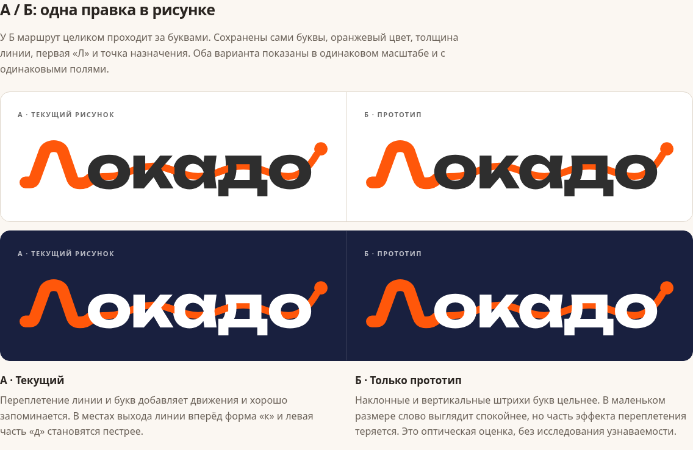

# Логотип Локадо: оценка и комплект SVG

Подготовлено по [задаче №133](https://github.com/glazkooov/locado/issues/133), 10 ноября 2026. Исходная версия проекта: `4cea24d66c632ec1b0ee842997156feb33942f84`.

**Рекомендация: сохранить концепцию и текущий рисунок.** Название читается, оранжевая «Л» задаёт движение, линия ведёт к точке назначения. Крупная переделка не нужна. У переплетения с «к» и «д» есть небольшая оптическая цена в мобильном размере; ниже показан один вариант её устранения. Выбор варианта и замена на сайте остаются отдельным шагом.

[Скачать комплект ZIP](locado-svg-kit.zip) · [Открыть сравнение HTML](review.html) · [Сравнение на компьютере](screenshots/comparison-desktop.png) · [Сравнение на телефоне](screenshots/comparison-mobile.png)

Чтобы посмотреть сравнение офлайн, распакуй ZIP и открой `review.html`. Все изображения для него находятся в архиве или встроены в HTML. На GitHub HTML показывается исходным кодом; картинки сравнения открываются прямо в браузере.

## Короткая оценка

| Что проверено | Вывод |
| --- | --- |
| Название | «Локадо» читается. Первая буква выглядит как начало маршрута и связывает название с отдельным знаком. |
| Маршрут и точка | Волна передаёт движение, точка даёт понятное завершение. Сама линия не сообщает о рекомендациях мест, это раскрывает окружение логотипа. |
| Линия и буквы | Переплетение добавляет характер. Выходы линии вперёд на «к» и слева у «д» дробят штрихи букв, особенно при ширине около 140 px. Ошибки чтения не доказаны: это визуальная оценка, без пользовательского исследования. |
| Отдельный знак | Силуэт «Л» достаточно простой для маленькой иконки. Он узнаваем как часть полного логотипа, но сам по себе не обозначает точку назначения; узнаваемость у новой аудитории не измерялась. |
| Шапка и подвал | Встроенные версии используют те же контуры и оранжевый `#FF570A`; буквы тёмные либо белые по фону. В проверенной главной дублирующихся ID нет. |
| Favicon, приложение, Telegram | Одна форма «Л» и одна палитра. У компактного знака правая оконечность завершена отдельно, у полного она переходит в слово. В favicon 16/24/32/48 px силуэт сохраняется; на 16 px окончания сильнее сглажены. Аватар проверен с круговой обрезкой. |
| Превью ссылки | В `assets/og-image.jpg` используется текущий рисунок. Белый PNG `assets/og/logo-white.png`, используемый `api/og-image.php`, также соответствует ему. Небольшое превью сохраняет название, но теряет детали переплетения. |
| Фоны и размер | Для светлого фона подходит primary, для тёмного inverse с белыми буквами. В мобильной шапке ширина SVG около 141 px; для новых самостоятельных вставок рекомендовано от 180 px. Для 16–48 px нужен отдельный знак. |
| Техническая пригодность | В исходном `assets/logo.svg` буквы уже в кривых, цвета явные, фон прозрачный. CSS и внешние шрифты не нужны. Однако правая точка касается края `viewBox`, а остальные поля неодинаковы. `clipPath` с общим ID `front` требует внимания при многократной inline-вставке исходника. |
| Старый файл | `assets/images/ui/logo1.png` содержит другую старую эмблему и латинское Locado. Ссылок на него в коде не найдено. В комплект он не включён; существующий файл не удалялся. |

## Готовые файлы: текущий рисунок

Все семь SVG в `current/` имеют прозрачный фон. В них нет `<text>`, шрифтов, CSS, внешних ресурсов, ID и ссылок на маски. Контуры букв сохранены; обводки маршрута и знака заданы внутри файлов и масштабируются вместе с ними.

| Файл | Применение |
| --- | --- |
| [locado-logo-primary.svg](current/locado-logo-primary.svg) | Полный логотип: тёмные буквы `#2E2E2E`, оранжевые «Л», маршрут и точка `#FF570A`. Светлые фоны. |
| [locado-logo-inverse.svg](current/locado-logo-inverse.svg) | Полный логотип: белые буквы, оранжевые «Л», маршрут и точка. Тёмные фоны. |
| [locado-logo-mono-dark.svg](current/locado-logo-mono-dark.svg) | Полный логотип одним тёмным цветом. Одноцветная печать на светлом. |
| [locado-logo-mono-white.svg](current/locado-logo-mono-white.svg) | Полный логотип полностью белым. Одноцветная печать и тёмные подложки. |
| [locado-mark-orange.svg](current/locado-mark-orange.svg) | Компактная «Л» оранжевым, без фоновой плашки. |
| [locado-mark-dark.svg](current/locado-mark-dark.svg) | Компактная «Л» тёмным, без фоновой плашки. |
| [locado-mark-white.svg](current/locado-mark-white.svg) | Компактная «Л» белым, без фоновой плашки. |

В экспортах выровнено небольшое техническое поле: 32 единицы с каждой стороны рисунка. Полный `viewBox` теперь `-1184.5 -872 5396.5 1041`; отрицательное начало корректно для SVG. Точка больше не касается границы. Внешнее охранное поле для макета добавляется отдельно, желательно не меньше высоты строчной «о».

Чтобы избежать конфликтов при нескольких inline-вставках, два передних участка линии преобразованы из `clipPath` в обычные залитые контуры. Сравнение с оригиналом при одинаковом `viewBox` на растре 2048 × 396 дало среднюю разницу каналов 0,00344 из 255; небольшие различия находятся на сглаженных краях. Компоновка текущего рисунка сохранена.

Белую версию используй на тёмном фоне. Для одноцветного логотипа лучше брать ширину от 180 px: линия внутри просветов букв становится того же цвета. Для небольших носителей предпочтителен знак. Не растягивай SVG непропорционально; при вставке через `` задай ширину и `height: auto`.

## Один вариант развития, только для выбора

В `prototype/` лежит один и тот же вариант в двух цветовых версиях:

- [Основной прототип](prototype/locado-logo-behind-primary.svg).
- [Прототип для тёмного фона](prototype/locado-logo-behind-inverse.svg).

Изменён только порядок слоёв: маршрут целиком проходит за буквами. Сохранены название, толщина и траектория линии, форма «Л», цвета, точка назначения и масштаб. Штрихи «к» и «д» выглядят цельнее; эффект переплетения слабее. Для общего ребрендинга оснований нет. Если текущая живость важнее небольшой разницы в читаемости, можно оставить А.

## Скриншоты проверки

- [Сравнение А/Б на телефоне, 390 px](screenshots/comparison-mobile.png).
- [Полный логотип при ширине 140/180/240 px, два фона](screenshots/sizes-desktop.png).
- [Favicon 16/24/32/48 px, аватар, иконка приложения и OG](screenshots/contexts-desktop.png).
- [Одноцветные версии на двух фонах](screenshots/mono-desktop.png).
- [Действующая шапка на телефоне, тёмный фон](screenshots/header-mobile-dark.png) и [после прокрутки, светлый фон](screenshots/header-mobile-light.png).
- [Действующая шапка на компьютере, тёмный фон](screenshots/header-desktop-dark.png) и [после прокрутки, светлый фон](screenshots/header-desktop-light.png).
- [Действующий подвал на компьютере](screenshots/footer-desktop-dark.png).

Снимки сайта сделаны с локальной исходной версии проекта, с часовым поясом Europe/Moscow. Аналитика и внешние сервисы при проверке отключены. Проверка не обращалась к Telegram API и не меняла аватар канала. Прототип показан только в отдельном сравнении.

## Проверка

- Chromium 156.0.8078.79: все 9 SVG открываются отдельными документами, без внешних ресурсов. Прозрачность и отсутствие обрезания проверены растеризацией шириной 2048 px; ни один край изображения не содержит закрашенных пикселей.
- Сравнение и текущая шапка проверены на ширинах 375, 390, 430 и 1280 px. Нет горизонтальной прокрутки, сломанных изображений или ошибок JavaScript. В HTML сравнения 33 изображения.
- [Машинный отчёт проверки SVG и вёрстки](verification.json).
- `npm run check`: проблем нет; 179 мест, 25 подборок, 211 страниц на телефоне и компьютере, 412 внутренних ссылок. Для запуска использованы временные PHP 8.4.27 и Playwright 1.65.0 из рабочей папки; зависимости проекта не менялись.

Существующие HTML, CSS, `assets/logo.svg`, `assets/favicon.svg`, PNG, аватар и файлы OG не изменены. Вся работа находится в этой папке с материалами для владельца. Реальная замена логотипа потребует отдельного выбора и реализации.
